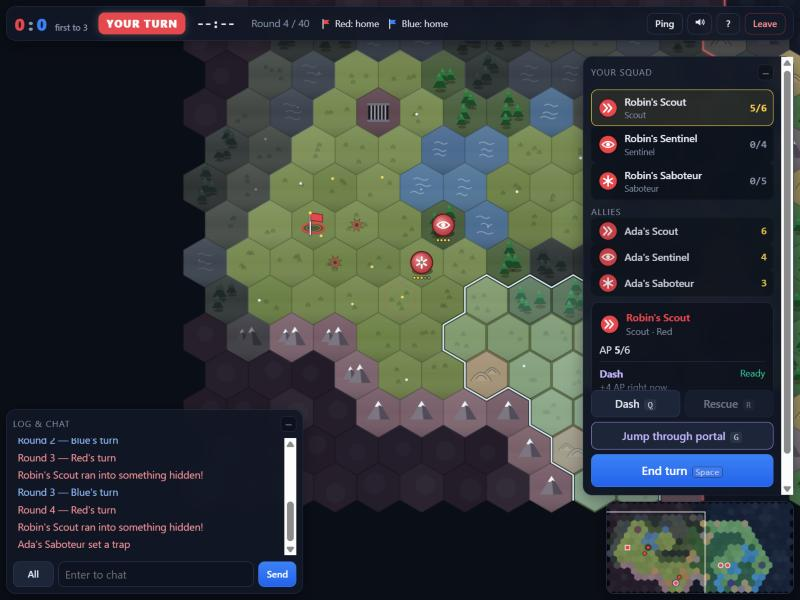

# Flagrant

**Turn-based capture the flag on a hex map, played in the browser with friends or bots.**

Sneak through the fog, grab the enemy flag and get it home — without getting tagged and thrown in jail. Every match is on a freshly generated map, there are no accounts, and a game is one link away: create a lobby, share the code, play.



## Features

- **Multiplayer in the browser** — up to 4 players or bots per team, public lobbies or private ones joined by code or invite link. No sign-up.
- **Generated hex maps** — plains, forest, hills, shallows, mountains, watchtowers and portals, always fair for both sides. Reroll the map or type a seed to replay one.
- **Fog of war** — you only see what your team sees. Forests hide units, hills and towers extend your view.
- **Tag and jail** — catch intruders in your territory and they sit in your jail, until a teammate breaks them out.
- **Three unit classes** — fast Scouts, long-reach Sentinels and trap-laying Saboteurs, each with a special ability.
- **Supply crates** — haste, cloak and shield pickups drop near the middle of the map.
- **Bots** — fill empty seats, or play alone against them. A bot also takes over if someone disconnects.

## Play it

You need [Node.js](https://nodejs.org) 18 or newer.

```
git clone https://github.com/Daenks/Flagrant.git
cd Flagrant
npm install
npm start
```

Then open http://localhost:3000.

- **Playing alone:** create a lobby, press **+ Bot** on each team and start.
- **Playing with friends:** friends on the same network can open `http://<your-ip>:3000` and join from the public list, by code, or with the invite link. To play over the internet, host it somewhere reachable or forward the port.
- **Trying multiplayer on one machine:** every browser tab is its own player.

### With Docker

```
docker compose up -d --build
```

Same address, http://localhost:3000. Stop it with `docker compose down`. To use a different port, set `FLAGRANT_PORT` (Docker) or `PORT` (Node) before starting.

## How to play

The same instructions are in the game: press **How to play** on the home screen or in a lobby, or `?` during a match.

Red starts on the left, Blue on the right. Teams take turns; everyone on the active team moves their own squad at the same time, then presses **End turn** (or the timer runs out). Each unit has action points (AP) to spend every turn.

- **Goal:** step on the enemy flag to grab it, then carry it to a hex next to your own flag stand. The first team to reach the capture target wins; if the round limit is reached, the higher score wins.
- **Tagging (3 AP):** you can tag an enemy standing in *your* territory. It drops the flag and goes to your jail for a few turns. Nobody can be tagged in the neutral strip down the middle, or on their own side.
- **Jailbreak (1 AP):** get a unit next to the enemy jail to free all your prisoners at once.
- **Flags:** a flag carrier is visible to everyone, but whoever grabs a flag is *safe* from tags until their next turn starts. A dropped flag can be picked up by an attacker, or returned by a defender stepping on it.
- **Handoff (1 AP):** a carrier can pass the flag to a teammate on the next hex, and a teammate can take it from a carrier who is stuck or out of AP. Each flag can change hands once per turn, and the new carrier doesn't inherit the *safe* protection.
- **Fog of war:** forests and mountains block line of sight, and units inside a forest are only seen from an adjacent hex. Hills and watchtowers see further and over forest. Enemies that slip out of view leave a "last seen" marker.

### Unit classes

| Class | AP | Vision | Special |
|---|---|---|---|
| Scout | 6 | 5 | **Dash** — +4 AP right now |
| Sentinel | 4 | 4 | Tags from 2 hexes away. **Flare** — reveals an area, including hidden units and traps, until your next turn |
| Saboteur | 5 | 4 | **Trap** — a hidden trap; an enemy stepping on it is stunned and loses its next turn |

### The map

| Terrain | Effect |
|---|---|
| Plains | 1 AP to enter |
| Forest, hills | 2 AP. Forest hides units; hills extend vision |
| Shallows | 3 AP |
| Mountains | Impassable, block vision |
| Watchtower | +3 vision while standing on it |
| Portal | Jump to the matching portal on the far side of the map for 1 AP |
| Supply crate | *Haste* (+3 AP), *cloak* (only visible from adjacent hexes) or *shield* (absorbs one tag) |

### Controls

| Action | Input |
|---|---|
| Select a unit, move, tag | Click the unit, then a highlighted hex or a crosshaired enemy |
| Ability / rescue / portal jump | `Q` / `R` / `G` |
| Pass or take the flag | `F` |
| End turn | `Space` |
| Next unit | `Tab` |
| Scroll the map | Drag, or `W` `A` `S` `D` / arrow keys |
| Zoom | Mouse wheel, pinch, or `+` / `-` |
| Back to your base | `H` |
| Ping your team | `P` then click, or Alt+click |
| Chat | `Enter` |
| Help | `?` |

The squad panel and the log can be dragged by their title bars, collapsed with the button in the title, and snapped back with a double-click.

## Lobby options

The host can set the map size (small, medium, large), units per player (1–4), captures to win, jail length, turn timer, round limit, and switch fog of war and portals on or off.

The **map seed** decides which map is generated: press **Reroll** for a new random one, or type a seed to replay a map (same seed and map size give the same map). The map stays hidden until the game starts, and a new seed is rolled after every game.

If a player disconnects mid-game a bot covers for them until they return; reloading the tab puts you back in your seat.

## For developers

Flagrant is a small Node.js server with one dependency ([`ws`](https://github.com/websockets/ws)) and a plain JavaScript canvas client with no build step. The server runs the rules and sends each player only what their team can see, so fog of war can't be bypassed from the browser.

```
server/index.js   HTTP static host + WebSocket lobbies, turn flow, timers
server/game.js    rules engine, vision, per-player snapshots
server/mapgen.js  symmetric hex map generator
server/hex.js     hex grid maths
server/bot.js     bot AI (plays with team knowledge only)
public/           browser client
docs/PROTOCOL.md  full rules and the wire protocol
test/sim.js       headless bot-vs-bot games with invariant checks
test/smoke.js     end-to-end lobby and game test over WebSocket
test/handoff.js   engine test for the flag handoff rule
```

Run the tests with `npm test` and the bot simulation with `npm run sim`.

## License

[PolyForm Noncommercial 1.0.0](LICENSE.md). You may use, modify and share Flagrant for any non-commercial purpose; commercial use is not permitted. This is a source-available licence, not an OSI open-source one.
